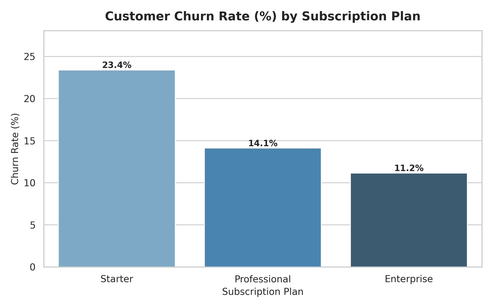
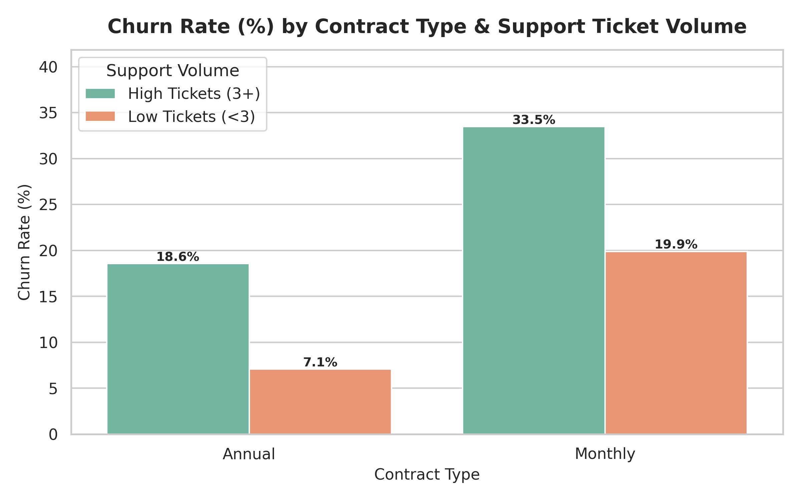
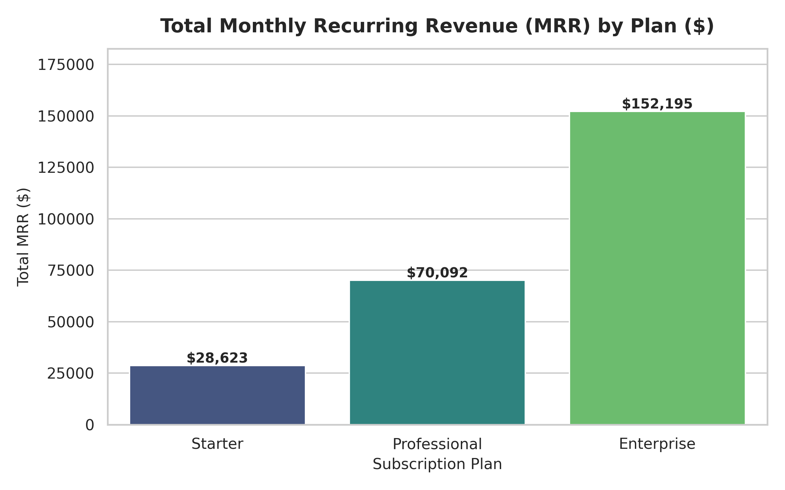

# SaaS Customer Churn & Subscription Analytics

End-to-end RevOps and customer analytics project analyzing Monthly Recurring Revenue (MRR), subscriber churn drivers, cohort retention signals, and support risk tiers using Python, SQL, and Power BI.

---

## Project Overview
This project evaluates 2,000+ SaaS customer subscription records to uncover early warning churn signals, measure revenue concentration across pricing tiers, and quantify the retention impact of annual vs. monthly billing contracts.

## Project Structure
- `data/` — SaaS subscription dataset (`saas_subscriptions.csv`).
- `sql/` — Production-ready SQL queries (`saas_churn_analysis.sql`) for MRR aggregation, churn rates, and support risk segmentation.
- `scripts/` — Automated Python metrics & visualization pipeline (`run_saas_pipeline.py`).
- `outputs/` — Pre-generated summary KPI CSVs and high-resolution Matplotlib/Seaborn charts.
- `powerbi/` — DAX measures and dashboard setup guide (`powerbi_dax_guide.md`).

---

## Key Business Insights & Visuals

1. **Plan-Level Churn Behavior:** Starter tier accounts experience the highest churn velocity, whereas Enterprise customers exhibit strong stickiness.


2. **Contract & Support Friction:** Monthly subscribers with 3+ support tickets churn at a dramatically higher rate than annual subscribers with low support friction.


3. **MRR Revenue Concentration:** Despite lower headcount, Enterprise and Professional tiers generate the vast majority of Monthly Recurring Revenue.


---

## How to Reproduce or Run
1. **Clone the Repository:**
   ```bash
   git clone https://github.com/VinithaKamidi/saas-customer-churn-analytics.git
   ```
2. **Run the Python Pipeline:**
   ```bash
   python scripts/run_saas_pipeline.py
   ```
3. **Power BI Setup:**
   - Import `data/saas_subscriptions.csv` into Power BI Desktop.
   - Apply the DAX formulas documented in `powerbi/powerbi_dax_guide.md`.
